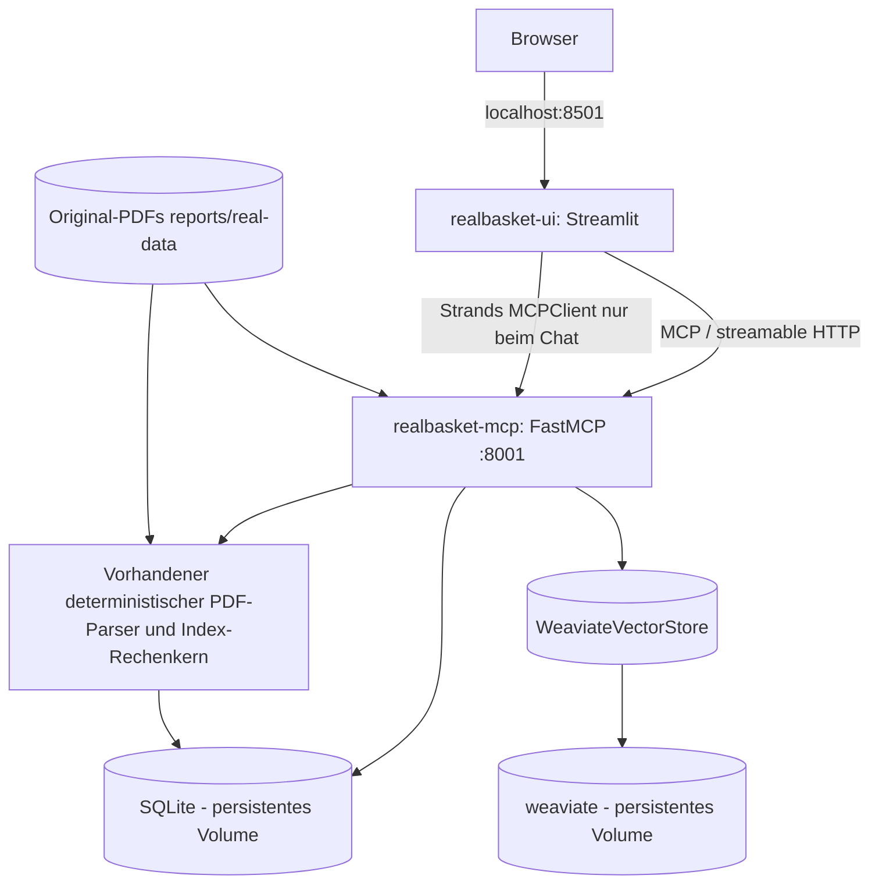

# RealBasket – Drei-Dienste-Deployment über Docker Compose

## Architektur (implementierter Stand)



**Keine direkten lokalen Data-Imports in `ui/app.py`:** Dashboard, Prüfung, PDF-Downloads,
Indexvisualisierung und Chat nutzen `real_basket.mcp_server.client.call_tool` bzw. den Strands MCPClient.
Der MCP-Server ist die einzige Grenze zu Daten, Rechenfunktionen und Storage.

**Besonderheit:** Der bisherige ECLI-Rechenkern verwendet weiterhin die validierten PDF-Tabellen
als kanonische numerische Datenbasis. SQLite hält einen persistierten, quellenbezogenen Spiegel.
Neu hochgeladene, anders aufgebaute PDFs (z. B. Nettogehälter) werden nicht stillschweigend akzeptiert.
Sie benötigen einen eigenen Parser, Validierung und Rechenintegration.

## Start unter Windows / PowerShell

Voraussetzungen: Docker Desktop mit laufender Linux-Engine, Docker Compose V2.

```powershell
cd <Repository>\real-basket
Copy-Item .env.example .env
# Bearbeite .env: OPENAI_API_KEY oder Azure-OpenAI-Konfiguration
# Für automatische Vektor-Ingestion beim MCP-Start: REALBASKET_AUTO_INDEX_VECTOR=true

docker compose up --build -d
docker compose ps
docker compose logs -f realbasket-mcp
```

- Dashboard: http://localhost:8501
- MCP: http://localhost:8001/mcp (MCP-Protokoll, nicht normale Browser-Webseite)
- Weaviate: http://localhost:8080/v1/.well-known/ready

**Wichtig:** In Docker adressiert Streamlit den MCP-Service unter
`http://realbasket-mcp:8001/mcp`, **nicht** `localhost:8001`.

Für einen erfolgreichen Start muss `.env` nicht zwingend einen Modell-Key enthalten; Dashboard,
SQLite-Import und deterministische Rechnung arbeiten ohne LLM. Für Chat und
Weaviate-Vektorsuche sind Zugangsdaten für die jeweiligen Modelle nötig.
Bei `REALBASKET_AUTO_INDEX_VECTOR=false` wird Weaviate nur gestartet, aber nicht
automatisch befüllt. Nach Konfiguration eines Embedding-Anbieters:

```powershell
docker compose exec realbasket-mcp python -m real_basket.storage --mode vector
```

Danach kann der Tab **PDF-Suche (Weaviate)** über `search_documents` suchen.

## Betriebsprüfung

```powershell
docker compose ps
docker compose logs realbasket-ui --tail=40
docker compose logs realbasket-mcp --tail=60
docker compose exec realbasket-mcp python -m real_basket.storage --mode sql
```

Unter Dashboard → Index vs. VPI sollten geprüfte, modellierte Eurokosten und der
Index erscheinen. In Methodenhinweise nach Vektor-Import eine Frage stellen,
dann im Chat eine Indexfrage stellen und den angezeigten MCP-Toolnamen prüfen.

## Stop / Reset

```powershell
docker compose down                     # Datenvolumes bleiben erhalten
docker compose down -v                  # ACHTUNG: löscht SQLite/Weaviate-Volumes
```

## Datenschutz und Produktion

- Ports werden aus Sicherheitsgründen nur an `127.0.0.1` veröffentlicht.
- Weaviate erlaubt in dieser lokalen Entwicklerkonfiguration anonymen Zugriff;
  niemals unverändert im öffentlichen Netzwerk exponieren.
- MCP muss vor öffentlichem Betrieb TLS, Authentisierung und Zugriffskontrolle erhalten.
- Original-PDFs werden per Read-Only-Mount aus `reports/real-data` eingebunden.
- Private Zugangsdaten nur in `.env` (nicht ins Repository committen).
- Ein PDF-Upload über die Weboberfläche ist **nicht geplant** (Entscheidung 11/2026). Neue Quell-PDFs werden
  über den Quellenordner `reports/real-data` und die Ingestion-CLI übernommen.
- Es gibt noch keinen validierten Gehalts-PDF-Importer und keinen fertigen EPPI.
