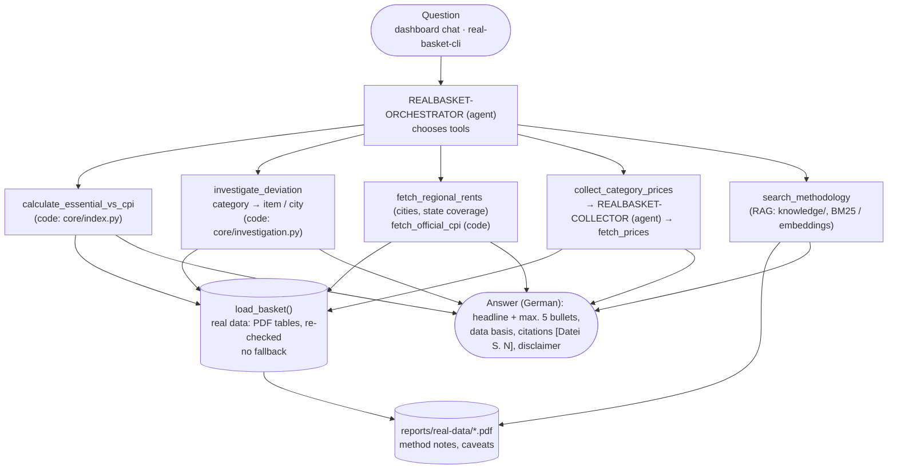

# Process: agentic analysis with a deterministic core

> Status: November 2026. Optimised for the hackathon demo: one interactive agent, no background runs.
> The earlier non-deterministic monitoring flow (Strands Graph with planner, collector, validator, analyst,
> reporter, human approval and data store) was removed; it is available in git history up to commit `f9344ef`.

## 1. Design principle

**Non-deterministic shell, deterministic core.**

- **LLM agent decides:** which tools a question needs, in which order, how deep to drill down, and how to word
  the answer (always German).
- **Code decides:** every number (index, YoY rates, deviation, driver contributions, city rents). An LLM never
  calculates an inflation rate. The disclaimer is part of the system prompt and always shown in the dashboard.
- **Reference documents** (`reports/real-data`) serve two separate purposes:
  - *Tables → real data* (`data/real_data.py`): parsed deterministically (no LLM, no text search), 11 re-checks
    in code (sums, gaps, printed ECLI and yearly rates reproduced by the engine, consistency across reports, city
    rents, federal-state coverage).
  - *Prose → method notes (RAG)*: context and caveats only, never figures.
- **Real data only:** there is no synthetic demo data and no fallback. If the PDFs are missing or unreadable,
  `load_basket()` raises `RealDataError`; the dashboard shows the error and every tool returns `{"error": …}`.
  Untouched weight sliders use the exact (unrounded) basket weights, so dashboard, agent and printed ECLI agree.
- **No invented figures:** the sources contain no rent per federal state and no net salaries. The agent and the
  dashboard say so and show only which cities of a state have published rents.

## 2. Process diagram

Typical "why" path: `investigate_deviation(level='category')` → category with the largest |gap_pp| →
`level='item'` (or `'region'` for rent) → optional `search_methodology` for caveats.

## 3. Deviation drivers (deterministic)

For the latest month *t* and *t−12*:

- contribution_pp(c) = w_c × (I_c(t) − I_c(t−12)) ÷ E(t−12) × 100 — sums to the essential YoY rate
- gap_pp(c) = contribution_pp(c) − w_c × CPI YoY — sums to the deviation (essential YoY − CPI YoY)

The dashboard header shows the category with the largest |gap_pp| as "Größter Einflussfaktor" (biggest driver).

## 4. Method notes (RAG)

| Step | Implementation |
|------|----------------|
| Ingest | pypdf text per page; repeated headers removed; prose blocks → `note` passages, non-numeric table cells → `table` passages; numeric cells dropped; identical passages across yearly reports deduplicated with all locations |
| Index | `data_store/knowledge/index.json`, rebuilt when file size / mtime of a PDF changes |
| Retrieval | `bm25` offline (German stemming, compounds, English → German glossary); `embedding` (OpenAI) fused with BM25 by reciprocal rank fusion; `auto` picks embedding if a key is set; errors fall back to BM25 |
| Use | Chat tool `search_methodology` (cite as `[file p. N]`), dashboard tab 📚 Method notes, CLI `real-basket-knowledge` |
| Guardrail | Prompt + tool docstring: never take figures from passages; numbers only from the calculation tools |

## 5. Risks and mitigations

| Risk | Mitigation |
|------|------------|
| Hallucinated numbers | All figures from deterministic tools; prompt forbids own calculations |
| Misreading the deviation as "CPI is wrong" | Disclaimer in prompt, dashboard header and PDFs |
| Invented regional figures | No state rents / salaries in the sources → tools return the coverage only, prompt forbids estimates |
| Misparsed PDF tables | 11 deterministic re-checks, shown in the dashboard (Datenprüfung) and the VPI report |
| PDFs missing on another machine | Reference PDFs versioned in git; relative paths resolved against the project root; otherwise a clear error (no fallback) |
| Figures quoted from PDFs | Numeric table cells are not indexed; passages are context only |
| No API key during the demo | Dashboard, drivers, PDFs and method-note search (BM25) work offline; only the chat needs a key |

## 6. Out of scope for the hackathon

Scheduled monitoring with validation / retry loops, human approval, audit trail and source memory (see git
history `f9344ef`), live data collectors (Destatis GENESIS), verified federal-state rent series and net salaries
(new sources needed; then rent burden).
