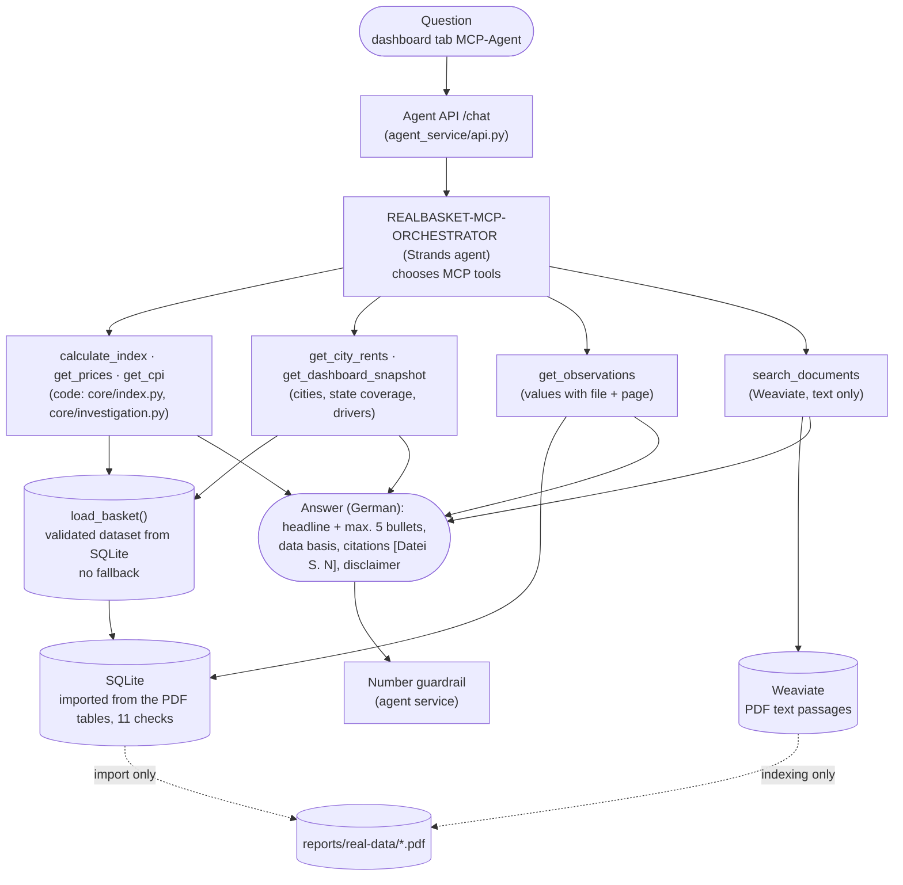

# Process: agentic analysis with a deterministic core

> Status: November 2026. Optimised for the hackathon demo: one interactive MCP agent, no background runs.
> Earlier designs (a Strands Graph with planner, collector, validator, analyst, reporter and human approval, up
> to commit `f9344ef`; later a local CLI orchestrator with a collector sub-agent) were removed.

## 1. Design principle

**Non-deterministic shell, deterministic core.**

- **LLM agent decides:** which MCP tools a question needs, in which order, and how to word the answer (always
  German).
- **Code decides:** every number (index, YoY rates, deviation, driver contributions, city rents). An LLM never
  calculates an inflation rate. The disclaimer is part of the system prompt and always shown in the dashboard.
- **Reference documents** (`reports/real-data`) serve two separate purposes:
  - *Tables → real data*: `python -m real_basket.storage --mode sql` parses them deterministically
    (`data/real_data.py`, no LLM, no text search), runs 11 re-checks (sums, gaps, printed ECLI and yearly rates
    reproduced by the engine, consistency across reports, city rents, federal-state coverage) and writes the
    validated dataset to **SQLite** – the single read source of all figures.
  - *Prose → PDF search*: `--mode vector` chunks the text (numeric cells dropped) into **Weaviate**; context and
    caveats only, never figures.
- **Real data only:** there is no synthetic demo data and no fallback. If the SQLite import is missing
  (PDFs missing, unreadable or a check failed), `load_basket()` raises `RealDataError`; the dashboard shows the
  error and every tool returns `{"error": …}`.
- **No invented figures:** the sources contain no rent per federal state and no net salaries. The agent and the
  dashboard say so and show only which cities of a state have published rents.
- **Number guardrail:** the agent service checks every figure of the answer against the tool results of the
  question and flags unbacked figures (`agents/guardrail.py`).

## 2. Process diagram

Typical "why" path: `get_dashboard_snapshot` or `calculate_index` → category with the largest |gap_pp| →
`get_prices(category)` for the item detail → optional `search_documents` for caveats.

## 3. Deviation drivers (deterministic)

For the latest month *t* and *t−12*:

- contribution_pp(c) = w_c × (I_c(t) − I_c(t−12)) ÷ E(t−12) × 100 — sums to the essential YoY rate
- gap_pp(c) = contribution_pp(c) − w_c × CPI YoY — sums to the deviation (essential YoY − CPI YoY)

The dashboard header shows the category with the largest |gap_pp| as "Größter Einflussfaktor" (biggest driver).

## 4. PDF search (Weaviate)

| Step | Implementation |
|------|----------------|
| Ingest | `knowledge/ingest.py`: pypdf text per page; repeated headers removed; prose blocks → `note` passages, non-numeric table cells → `table` passages; numeric cells dropped; identical passages across yearly reports deduplicated with all locations |
| Index | `python -m real_basket.storage --mode vector` → `storage/weaviate_store.py`: Azure OpenAI / OpenAI embeddings, collection `RealBasketDocuments`, deterministic uuid5 IDs |
| Retrieval | MCP tool `search_documents(query, top_k, year)`: similarity search, optional year filter |
| Use | Dashboard tab "PDF-Suche (Weaviate)" and the chat agent (cite as `[Datei S. N]`) |
| Guardrail | Prompt + tool result warning: never take figures from passages; numbers only from the calculation tools |

## 5. Risks and mitigations

| Risk | Mitigation |
|------|------------|
| Hallucinated numbers | All figures from deterministic tools; prompt forbids own calculations; number guardrail |
| Misreading the deviation as "CPI is wrong" | Disclaimer in prompt, dashboard header and PDFs |
| Invented regional figures | No state rents / salaries in the sources → tools return the coverage only, prompt forbids estimates |
| Misparsed PDF tables | 11 deterministic re-checks at import; an import is written only if all pass; shown in the dashboard and the VPI report |
| PDFs missing on another machine | Reference PDFs versioned in git; import at container start; otherwise a clear error (no fallback) |
| Figures quoted from PDFs | Numeric table cells are not indexed; passages are context only |
| No API key during the demo | Dashboard, drivers and PDF reports work without an LLM; chat and PDF search need the Azure OpenAI settings |

## 6. Out of scope for the hackathon

Scheduled monitoring with validation / retry loops, human approval, audit trail and source memory (see git
history `f9344ef`), live data collectors (Destatis GENESIS), verified federal-state rent series and net salaries
(new sources needed; then rent burden).
