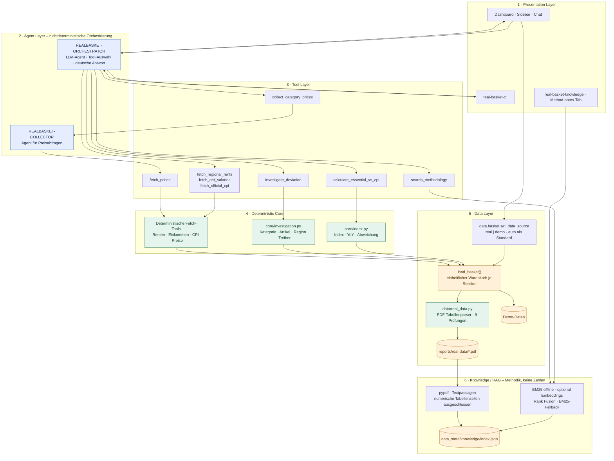
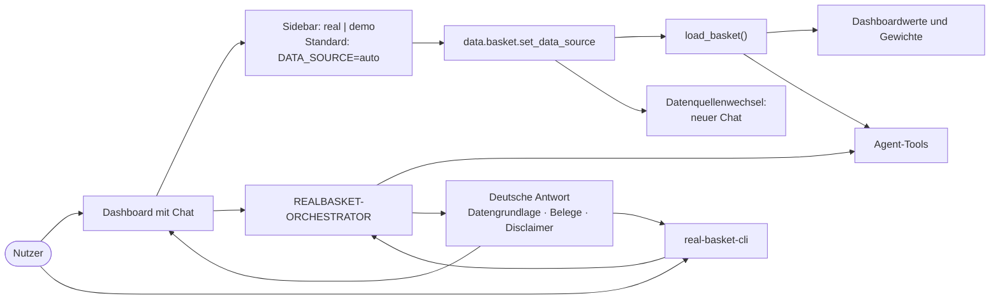
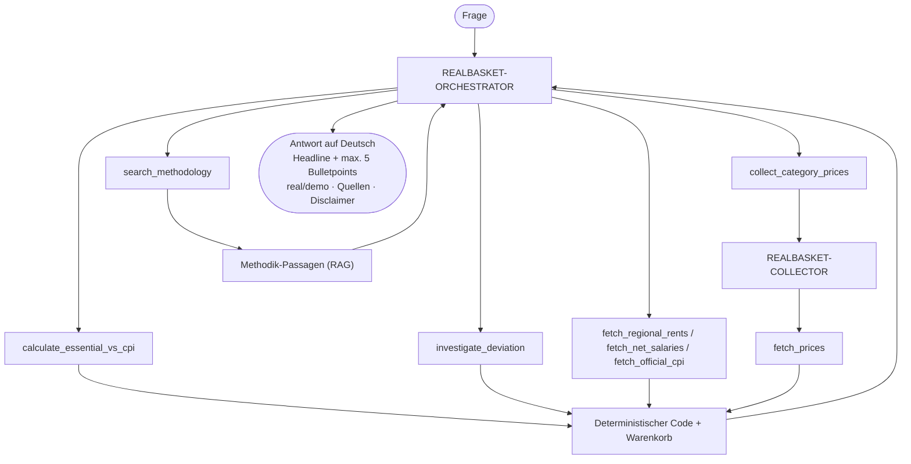
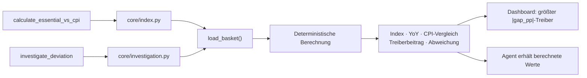
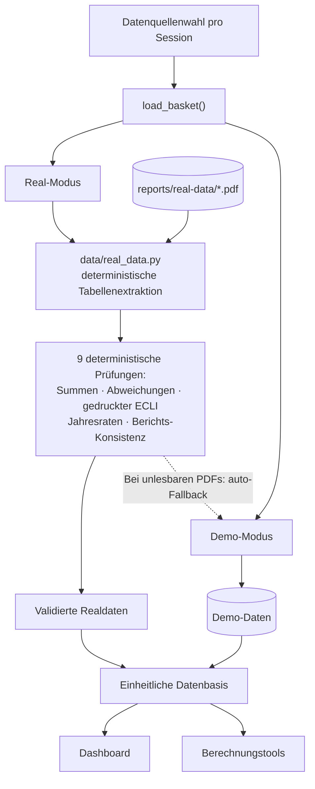
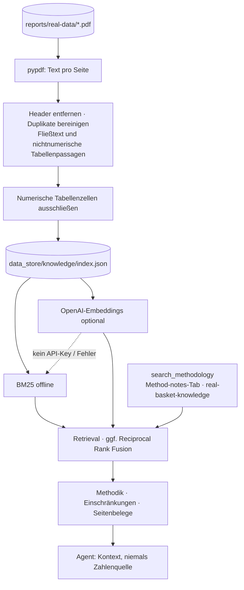

# REALBASKET – Komponentenarchitektur

> Grundlage: `process-redesign.md` (November 2026). Architekturansicht des beschriebenen Hackathon-Demosystems, **kein** geplanter Monitoring-Workflow. Die Aufteilung in Layer ist eine Visualisierung der beschriebenen Zuständigkeiten; sie definiert keine zusätzlichen Services oder APIs.

## 1. Gesamtarchitektur nach Komponenten

**Regeln:** Der Agent wählt Tools und formuliert die Antwort, berechnet aber keine Kennzahlen. Zahlen entstehen ausschließlich im deterministischen Code. PDF-Tabellen dienen als numerische Datenbasis; PDF-Fließtext wird ausschließlich für Methodik und Einschränkungen durchsucht.

## 2. Komponente: Presentation und Session

Unveränderte Gewichtsregler verwenden die exakten, ungerundeten Warenkorbgewichte. Dashboard, Tools und veröffentlichter ECLI sollen übereinstimmen.

## 3. Komponente: Agenten und Tool-Orchestrierung

Beispiel für eine Warum-Frage: `investigate_deviation(level='category')` → Kategorie mit dem größten absoluten `gap_pp` → `level='item'` (bzw. `region` für Mieten) → optional `search_methodology` für methodische Einschränkungen.

## 4. Komponente: Deterministic Core und Kennzahlen

Für Monat `t` gegenüber `t−12`:

- `contribution_pp(c) = w_c × (I_c(t) − I_c(t−12)) / E(t−12) × 100`
- `gap_pp(c) = contribution_pp(c) − w_c × CPI_YoY`

Die Summe der Beiträge ergibt die essentielle YoY-Rate; die Summe der `gap_pp` entspricht der Differenz zwischen essentieller YoY-Rate und CPI-YoY.

## 5. Komponente: Datenbasis und Validierung

Jedes Tool kennzeichnet die Datenquelle (`real` oder `demo`). Die Quelle wird pro Session einheitlich gehalten, damit keine realen und simulierten Zahlen vermischt werden.

## 6. Komponente: Knowledge / RAG

Der Index wird bei Änderungen von PDF-Dateigröße oder Änderungszeitpunkt neu aufgebaut. Ohne Embedding-Zugang funktioniert BM25 offline.

## 7. Architekturgrenzen

Nicht Bestandteil dieser Version sind geplante Hintergrundausführungen, Monitoring mit Retry- und Validierungsloops, Human Approval, Audit Trail, Source Memory, Live-Destatis-GENESIS-Collector sowie reale Bundesland-Mieten und Nettogehälter. Der frühere Monitoring-Workflow ist laut Quelldokument in der Git-Historie bis `f9344ef` enthalten.

## 8. Mermaid in VS Code anzeigen

Die Datei als `.md` öffnen und mit `Ctrl + Shift + V` die Markdown-Vorschau aufrufen. Jedes der sechs Diagramme steht in einem eigenen `mermaid`-Codeblock.

---

*Quellbasis: `process-redesign.md`, Stand November 2026. Die Pfeile sind Architektur-/Datenabhängigkeiten; sie sind keine Behauptung über Netzwerk-Deployments oder physische Microservices.*
